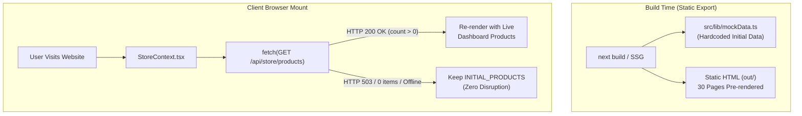
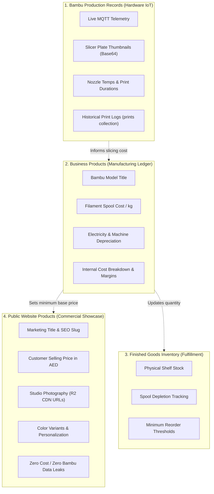
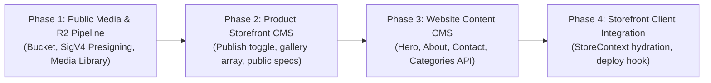

# Website CMS Architecture Audit & Integration Blueprint
## Public Website ↔ Business Dashboard Content Management Integration

**Document Version:** 1.0.0-AUDIT  
**Audit Classification:** READ-ONLY Architecture Discovery & Technical Feasibility Assessment  
**Audit Execution Date:** November 18, 2026 (GST)  
**Target Systems:**
1. **Print Studio Website** (`print-studio-website` — `/Users/subhamsantra/Desktop/3D PRINTING/3D printing Website`)
2. **Print Studio Dashboard** (`print-studio-app` — `/Users/subhamsantra/Desktop/3D PRINTING/3D printing dashboard`)

---

## Executive Summary

This architecture discovery audit investigates the technical path for making the public-facing **Print Studio Website** manageable through the existing private **Print Studio Dashboard** without code changes, manual file replacements, or developer intervention.

### Empirical Safety Declarations & Pre-Audit Constraints
* **Zero System Modifications:** This audit is strictly non-destructive and read-only. No source files were modified, no migrations executed, no packages installed, no database rows altered, and no builds deployed.
* **Production Integrity Guarantee:** The live Neon Lakebase PostgreSQL production database (`production` branch `br-noisy-haze-aziu7zel`), its verified **371 baseline legacy records**, Bambu Cloud MQTT integration, and existing Phase 1 & 2 public endpoints (`/api/store/*`) are completely protected and unaffected by this audit.
* **Separation of Concerns:** The core operational distinction between **Bambu production records**, **internal business manufacturing models**, **finished goods inventory**, and **publicly published commercial storefront items** has been rigorously mapped and preserved.

---

## 1. Repository Structure & System Architecture Overviews

### 1.1 Print Studio Website (`print-studio-website`)

The public storefront is an independent Next.js application built with the App Router, optimized for static export and deployment on Cloudflare Pages or similar edge CDN infrastructures.

```
/Users/subhamsantra/Desktop/3D PRINTING/3D printing Website/
├── src/
│   ├── app/
│   │   ├── layout.tsx                   # Root HTML shell, fonts, global metadata, StoreProvider wrapper
│   │   ├── globals.css                  # Tailwind v4 theme tokens, Emil Kowalski motion primitives
│   │   ├── not-found.tsx                # Custom 404 error page with 3D Studio referrals
│   │   ├── page.tsx                     # Customer Homepage (Hero, Categories, Bestsellers, Benefits, Instagram)
│   │   ├── shop/
│   │   │   ├── page.tsx                 # Shop page server wrapper (generateMetadata, Suspense)
│   │   │   └── ShopPageClient.tsx       # Live catalogue, category filtering, search, pricing sliders
│   │   ├── products/
│   │   │   ├── page.tsx                 # Canonical route alias -> ShopPageClient
│   │   │   └── [slug]/
│   │   │       └── page.tsx             # Static SSG route (generateStaticParams, dynamic SEO metadata)
│   │   ├── custom-print/
│   │   │   ├── page.tsx                 # Custom 3D printing page server shell
│   │   │   └── CustomPrintPageClient.tsx# Interactive CAD quote estimator & RFQ submission interface
│   │   ├── custom/
│   │   │   └── page.tsx                 # Legacy canonical route alias -> CustomPrintPageClient
│   │   ├── about/
│   │   │   ├── page.tsx                 # About studio server shell & OpenGraph tags
│   │   │   └── AboutPageClient.tsx      # Studio craftsmanship story, capabilities, 4-step workflow
│   │   └── contact/
│   │       ├── page.tsx                 # Contact page server shell
│   │       └── ContactPageClient.tsx    # Workshop coordinates, Google Maps links, general enquiry form
│   ├── components/
│   │   ├── layout/
│   │   │   ├── Navbar.tsx               # Header, search modal, slide-over navigation drawer
│   │   │   └── Footer.tsx               # Studio footer, navigation directories, legal notice
│   │   ├── product/
│   │   │   ├── ProductCard.tsx          # Reusable catalogue item card with badges & wishlisting
│   │   │   ├── ProductDetailClient.tsx  # Product image gallery, finish picker, specs table, WhatsApp CTA
│   │   │   ├── QuickViewModal.tsx       # Fast-preview modal for product specifications
│   │   │   └── EnquiryModal.tsx         # Direct studio modal enquiry overlay
│   │   └── ui/
│   │       ├── BrandLogo.tsx            # SVG & image brand emblem renderer
│   │       ├── icons.tsx                # Tree-shaken HugeIcons SVG icons
│   │       ├── Modal.tsx                # Reusable accessible dialog backdrop
│   │       ├── SafeImage.tsx            # Image loader with graceful placeholder fallback
│   │       ├── ToastContainer.tsx       # Accessible feedback toasts
│   │       └── WhatsAppButton.tsx       # Floating & inline direct WhatsApp contact triggers
│   ├── context/
│   │   └── StoreContext.tsx             # Central React state, local persistence, live API hydrator
│   └── lib/
│       ├── api.ts                       # Fetch client for GET /api/store/products and POST submissions
│       ├── constants.ts                 # Studio brand metadata & telephone fallbacks
│       ├── mockData.ts                  # Static initial products, categories, gallery, and settings
│       ├── storeLogic.ts                # Filtering, slugification, pricing, and WhatsApp URL builders
│       └── types.ts                     # Strict TypeScript interfaces for products, RFQs, and settings
├── public/
│   ├── _redirects                       # Cloudflare Pages SPA/rewrites configuration
│   ├── robots.txt                       # Search engine crawler policies
│   └── assets/
│       ├── aistudio/                    # Brand logos and promotional cover identity banners
│       └── images/                      # Master product photography, category hero images (12 assets)
├── next.config.ts                       # output: "export", trailingSlash: true, unoptimized: true
├── package.json                         # Next.js 15.1.7, React 19, Motion 14, Tailwind CSS 4.0
└── tsconfig.json                        # Strict TypeScript 5.7 configuration
```

#### Technical Profile: Website
* **Runtime & Framework:** Next.js 15.1.7 (App Router), React 19.0.0.
* **Export Strategy:** `output: "export"`, `trailingSlash: true`, `images.unoptimized: true` in `next.config.ts`. Pre-renders all 30 HTML pages at build time.
* **State & Data Layer:** `StoreContext.tsx` loads `INITIAL_PRODUCTS` and settings from `mockData.ts` on initialization, then asynchronously queries the dashboard's `GET /api/store/products?limit=50` on client mount to rehydrate with published commercial products.
* **Styling & Motion:** Tailwind CSS v4, custom CSS properties in `globals.css`, hardware-accelerated spring transitions via `motion/react`.

---

### 1.2 Print Studio Dashboard (`print-studio-app`)

The dashboard is a commercial management and manufacturing control platform connecting directly to Neon Lakebase PostgreSQL, Bambu Lab cloud printers via MQTT/REST, and private Cloudflare R2 object storage.

```
/Users/subhamsantra/Desktop/3D PRINTING/3D printing dashboard/
├── src/
│   ├── app/
│   │   ├── page.tsx                     # Dynamic client entry point loading PrintStudioLedger
│   │   ├── layout.tsx                   # Root administrative layout
│   │   ├── globals.css                  # Base styles
│   │   ├── ledger.css                   # Comprehensive design system (2,700+ lines)
│   │   ├── business-workspace.css       # Commercial console CSS (Phase 2)
│   │   ├── admin/                       # Modern Next.js App Router Commercial Hub
│   │   │   ├── page.tsx                 # Commercial Overview Console (BusinessWorkspaceLayout)
│   │   │   ├── products/page.tsx        # Commercial Product Management (Placeholder)
│   │   │   ├── orders/page.tsx          # Commercial Customer Orders (Placeholder)
│   │   │   ├── inventory/page.tsx       # Spool & Batch Inventory (Placeholder)
│   │   │   ├── enquiries/page.tsx       # Storefront Inquiries Triage (Placeholder)
│   │   │   ├── quotations/page.tsx      # RFQ & CAD File Review (Placeholder)
│   │   │   ├── customers/page.tsx       # Customer Registry & KYC (Placeholder)
│   │   │   ├── expenses/page.tsx        # Studio Overhead & Raw Materials (Placeholder)
│   │   │   ├── reports/page.tsx         # Financial & Production Analytics (Placeholder)
│   │   │   ├── settings/page.tsx        # Studio Commercial Preferences (Placeholder)
│   │   │   └── production/page.tsx      # Direct link to live Bambu additive manufacturing
│   │   └── api/
│   │       ├── health/route.ts          # Neon DB health check probe
│   │       ├── data/route.ts            # Authenticated CRUD for public.ledger_collections
│   │       ├── bambu/sync/route.ts      # Bambu Cloud print job ingestion & plate photo sync
│   │       ├── admin/auth/              # Session authentication (login, logout, me)
│   │       └── store/                   # Public Sanitized Storefront API Endpoints
│   │           ├── products/route.ts    # GET /api/store/products (filtered by published=true)
│   │           ├── products/[slug]/     # GET /api/store/products/[slug] (single item lookup)
│   │           ├── enquiries/route.ts   # POST /api/store/enquiries (rate-limited customer inbox)
│   │           ├── quotes/presign/      # POST /api/store/quotes/presign (SigV4 R2 presigning)
│   │           └── quotes/route.ts      # POST /api/store/quotes (atomic RFQ persistence)
│   ├── components/
│   │   ├── PrintStudioLedger.tsx        # Administrative shell mounting ledgerCore.js
│   │   ├── ledgerCore.js                # Core single-page studio application (8,451 lines)
│   │   ├── admin/
│   │   │   ├── BusinessWorkspaceLayout  # Modern App Router commercial layout & navigation
│   │   │   └── ModulePlaceholderView    # Phase 2 preview shell for modular business expansion
│   │   ├── hugeIcons.tsx                # HugeIcons SVG bundle integration
│   │   └── FilamentSpool.tsx            # Parametric SVG filament spool generator
│   └── lib/
│       ├── db.ts                        # Neon serverless HTTP client & interactive transaction runner
│       ├── auth.ts                      # Argon2id password hashing, session tokens, rate limits, audits
│       ├── server-auth.ts               # Server-side Next.js App Router session verification
│       ├── origin.ts                    # Strict Storefront Origin & CSRF defense validator
│       ├── storefront.ts                # Public product whitelisting, sanitization & input validators
│       ├── r2.ts                        # Cloudflare R2 AWS SigV4 presigning & object verification
│       └── filaments.ts                 # Master filament catalog & spool tracking
├── migrations/
│   ├── 0001_phase1_auth_foundation.sql  # Users, sessions, rate limits, audit logs
│   ├── 0002_phase2_storefront_foundation.sql # store_enquiries, store_quote_requests, store_quote_files
│   └── 0003_phase2_upload_intents.sql   # store_upload_intents (CAD quarantine & token-binding)
├── backups/                             # Verified compressed database dumps (Phase 0)
├── docs/                                # Baseline audits and architecture blueprints
├── next.config.ts                       # devIndicators: false
└── package.json                         # Next.js 16.4.6, React 19.3.0, @neondatabase/serverless 1.2.0
```

#### Technical Profile: Dashboard
* **Framework:** Next.js 16.4.6 (App Router), React 19.3.0.
* **Database Client:** `@neondatabase/serverless` 1.2.0 (Neon HTTP querying with `withTransaction` Client support).
* **Authentication:** Stateful server sessions in PostgreSQL (`public.sessions`), cryptographically hashed 256-bit tokens in `__Host-admin_session` HTTP-only cookies, Argon2id password hashing (`@node-rs/argon2`).
* **Storage Engine:** Cloudflare R2 integrated via AWS SigV4 signed headers in `src/lib/r2.ts` for private CAD file uploads (`.step`, `.stl`, `.3mf`, `.obj`, max 50MB).

---

## 2. Complete Public Website Content Inventory

Every customer-facing page on the public website was audited to distinguish static interface chrome from dynamic business content that a studio manager should be able to update from the dashboard.

### 2.1 Homepage (`src/app/page.tsx`)

| Section | Content Item | Current Location / Key | Current Source | Dashboard CMS Requirement |
|---|---|---|---|---|
| **Hero** | Eyebrow Text | `"3D Studio · Dubai, UAE"` | Hardcoded JSX (line 71) | Editable Hero Eyebrow |
| **Hero** | Main Heading | `"Turning Ideas Into Tangible Creations."` | Hardcoded JSX (line 75) | Editable Hero Title |
| **Hero** | Subtitle Copy | `"Discover thoughtfully designed 3D printed creations..."` | Hardcoded JSX (line 79) | Editable Hero Description |
| **Hero** | Primary Button | `"Explore Products"` -> `/shop` | Hardcoded JSX (line 88) | Editable Label & Destination |
| **Hero** | Secondary Button | `"Create Something Custom"` -> `/custom-print` | Hardcoded JSX (line 98) | Editable Label & Destination |
| **Hero** | Trust Indicators (3x) | `"Local Dubai Production"`, `"2–4 Day Turnaround"`, `"Bespoke & Corporate Orders"` | Hardcoded JSX (lines 106-110) | Editable Key Differentiators |
| **Hero** | Main Hero Visual | `HERO_IMAGE` (`/assets/images/hero_creations_dubai_1794842125042.jpg`) | `src/lib/mockData.ts` (line 10) | **Editable Primary Hero Image** |
| **Categories** | Section Title | `"Shop by Category"` | Hardcoded JSX (line 138) | Editable Section Heading |
| **Categories** | Section Subtitle | `"Explore curated collections crafted for homes..."` | Hardcoded JSX (line 141) | Editable Section Subtitle |
| **Categories** | Category Cards (6x) | Names, descriptions, slugs, images | `INITIAL_CATEGORIES` in `mockData.ts` | **Editable Categories & Thumbnails** |
| **Bestsellers** | Section Title | `"Best Sellers"` | Hardcoded JSX (line 206) | Editable Section Heading |
| **Bestsellers** | Bestseller Items | Top 8 items with `isAvailable` & sorted by `salesCount` | `StoreContext.tsx` / `mockData.ts` | **Dynamic via Product Publish Status** |
| **Custom CTA** | Eyebrow Text | `"Bespoke Fabrication & Prototyping"` | Hardcoded JSX (line 247) | Editable Banner Eyebrow |
| **Custom CTA** | Banner Title | `"Have an Idea? Let's Bring It to Life."` | Hardcoded JSX (line 250) | Editable Banner Title |
| **Custom CTA** | Banner Copy | `"From personalized gifts to prototypes..."` | Hardcoded JSX (line 253) | Editable Banner Body Copy |
| **Custom CTA** | Banner CTA Button | `"Request a Custom Print"` -> `/custom-print` | Hardcoded JSX (line 263) | Editable Banner Button |
| **Custom CTA** | Feature Visual | `WORKSHOP_IMAGE` (`custom_studio_workbench_1794842125376.jpg`) | `src/lib/mockData.ts` (line 11) | **Editable Workshop Feature Photo** |
| **Why Choose** | Section Title | `"Why Choose 3D Studio"` | Hardcoded JSX (line 291) | Editable Section Title |
| **Why Choose** | Benefits Grid (5x) | Titles & descriptions (Precision, Personalization, Materials, Dubai-based, Custom ideas) | Array in `src/app/page.tsx` (lines 31-57) | Editable Studio Value Propositions |
| **Instagram** | Section Title | `"Follow Our Creations"` | Hardcoded JSX (line 340) | Editable Section Title |
| **Instagram** | Subtitle & Handle | `settings.instagramHandle` (`@3dstudio.dubai`) | `DEFAULT_STORE_SETTINGS` in `mockData.ts` | Editable Social Handle |
| **Instagram** | Gallery Posts (6x) | 6 photography cards with captions & target slugs | `INSTAGRAM_GALLERY` in `mockData.ts` | **Editable Social Gallery & Captions** |

---

### 2.2 Shop / Catalogue (`src/app/shop/ShopPageClient.tsx`)

| Section | Content Item | Current Location / Key | Current Source | Dashboard CMS Requirement |
|---|---|---|---|---|
| **Header** | Title & Description | `"Explore Our Creations"`, `"Browse ready-to-customize..."` | Hardcoded JSX (lines 84-89) | Editable Catalogue Header |
| **Filters** | Category Tabs | `"All Creations"` + Category names | `INITIAL_CATEGORIES` in `mockData.ts` | Derived from Category CMS |
| **Filters** | Price Thresholds | `0, 50, 100, 150, 250, 500` AED | Hardcoded JSX (lines 129-134) | Static UI Filter Range |
| **Filters** | Sort Options | Featured, Price Low-High, Price High-Low | Enum in `types.ts` | Static UI Sort Logic |
| **Product Grid** | Product Cards | Photo, Title, Category, Price, Personalizable badge, Stock dot | `StoreContext.tsx` (`products`) | **Directly Managed via Products CMS** |

---

### 2.3 Product Details (`src/components/product/ProductDetailClient.tsx`)

| Section | Content Item | Current Location / Key | Current Source | Dashboard CMS Requirement |
|---|---|---|---|---|
| **Media Gallery** | Primary Photo | `product.images[0]` | `mockData.ts` / API `imageUrl` | **Editable Main Product Photo** |
| **Media Gallery** | Additional Angles | `product.images[1..N]` | `mockData.ts` (local array) | **Editable Product Gallery Array** |
| **Product Core** | Title, SKU, Price | `product.name`, `product.sku`, `product.price` | `Product` object | **Editable Product Identity & Price** |
| **Badges** | Badges | `isBestSeller`, `isFeatured`, `supportsPersonalization` | `Product` object | **Editable Commercial Badges** |
| **Availability** | Stock Indicator | `"Available to order · In-studio batches & custom finishing"` | Hardcoded JSX (line 198) | Editable Availability Microcopy |
| **Description** | Marketing Copy | `product.description` | `Product` object | **Editable Rich Marketing Description** |
| **Options** | Color / Finish Palette | `product.colors: string[]` | `mockData.ts` | **Editable Product Colors / Materials** |
| **Options** | Personalization Input | Text field shown when `supportsPersonalization=true` | Condition in JSX (line 244) | **Editable Personalization Toggle** |
| **Specs Table** | Dimensions | `product.dimensions` | `mockData.ts` | **Editable Physical Dimensions** |
| **Specs Table** | Material Spec | `product.material` | `mockData.ts` | **Editable Material Technical Spec** |
| **Specs Table** | Print Finish | `product.finish` | `mockData.ts` | Editable Layer Height / Finish Spec |
| **Specs Table** | Turnaround Lead Time | `"2–4 Studio Working Days in Dubai"` | Hardcoded JSX (line 330) | Editable Lead Time Setting |
| **Specs Table** | Origin / Workshop | `"Dubai Industrial City / Al Quoz, UAE"` | Hardcoded JSX (line 336) | Editable Studio Facility Location |
| **Specs Table** | Care Instructions | `product.careInstructions` | `mockData.ts` | Editable Maintenance Instructions |
| **Related** | Cross-sell Items | 4 items sharing the same `categoryId` | Derived in JSX (lines 347-353) | Automated or Curated Related Items |

---

### 2.4 Custom Prints (`src/app/custom-print/CustomPrintPageClient.tsx`)

| Section | Content Item | Current Location / Key | Current Source | Dashboard CMS Requirement |
|---|---|---|---|---|
| **Header** | Eyebrow & Title | `"Custom Fabrication & Rapid Prototyping"`, `"Request a Custom 3D Print Quote"` | Hardcoded JSX (lines 136-140) | Editable Page Header |
| **Header** | Introduction Copy | `"From personalized corporate gifting to mechanical prototypes..."` | Hardcoded JSX (lines 142-144) | Editable Introduction Copy |
| **Form Config** | Supported Materials | `['PLA', 'PETG', 'ABS', 'Resin', 'Not Sure']` | Array in client (lines 22-28) | Editable Material Options |
| **Form Config** | Color Presets | `['White', 'Black', 'Orange', 'Red', 'Blue', 'Custom']` | Array in client (line 30) | Editable Color Options |
| **Form Config** | Budget Brackets | `AED 200–500`, `AED 500–1000`, `AED 1000–2500`, etc. | Dropdown in JSX (lines 351-358) | Editable Budget Ranges |
| **Materials Guide**| 4x Material Cards | PLA, PETG, ABS, Resin descriptions, tolerances, and use cases | Hardcoded JSX (lines 430-495) | **Editable Material Reference Guide** |
| **Process Steps** | 4x Workflow Steps | Share Concept -> Slicing Review -> Calibration -> Express Dispatch | Hardcoded JSX (lines 500-550) | Editable Customer Process Steps |
| **Offline Fallback**| Help Notice | WhatsApp escalation phone number | `settings.whatsappNumber` | Editable Studio Contact Number |

---

### 2.5 About Us (`src/app/about/AboutPageClient.tsx`)

| Section | Content Item | Current Location / Key | Current Source | Dashboard CMS Requirement |
|---|---|---|---|---|
| **Hero** | Title & Narrative | `"Crafted Layer by Layer in the Heart of Dubai."`, Studio history | Hardcoded JSX (lines 56-64) | **Editable About Page Story** |
| **Capabilities**| 4x Key Strengths | FDM & SLA, Arabic typography, Corporate gifting, UAE courier dispatch | Array in client (lines 14-19) | **Editable Studio Capabilities List** |
| **Imagery** | Main Workshop Visual | `WORKSHOP_IMAGE` (`custom_studio_workbench_1794842125376.jpg`) | `src/lib/mockData.ts` (line 11) | **Editable About Workshop Photo** |
| **Imagery** | Brand Showcase Visual | `COVER_REFERENCE_IMAGE` (`image_1120d0df.png`) | `src/lib/mockData.ts` (line 12) | **Editable Studio Identity Graphic** |
| **Workflow** | 4-Phase Sequence | Step 01 to 04 titles & descriptions | Array in client (lines 21-46) | Editable Production Sequence |
| **Emblem** | Circular Studio Crest | `STUDIO_LOGO_IMAGE` (`image_2d82fc9e.png`) | `src/lib/mockData.ts` (line 13) | Editable Studio Crest Graphic |
| **Statistics** | Layer Resolution Metric| `"0.12 mm"` & `"Smooth tactile surfaces..."` | Hardcoded JSX (lines 170-174) | Editable Technical Highlight Metric |
| **Statistics** | Turnaround Metric | `"2–4 Days"` & `"No overseas shipping delays..."` | Hardcoded JSX (lines 177-181) | Editable Speed Highlight Metric |
| **Statistics** | Delivery Metric | `"UAE Delivery"` & `"Direct delivery across Dubai..."` | Hardcoded JSX (lines 184-191) | Editable Logistics Highlight Metric |

---

### 2.6 Contact Us (`src/app/contact/ContactPageClient.tsx`)

| Section | Content Item | Current Location / Key | Current Source | Dashboard CMS Requirement |
|---|---|---|---|---|
| **Header** | Title & Description | `"Contact Our Dubai Studio"`, Support description | Hardcoded JSX (lines 88-94) | Editable Contact Header |
| **Coordinates** | Physical Location | `settings.storeLocation` (`"Dubai Industrial City..."`) | `mockData.ts` / `.env.local` | **Editable Studio Address** |
| **Coordinates** | Google Maps Link | `"https://maps.google.com/?q=Al+Quoz+Creative+District+Dubai"` | Hardcoded JSX (line 108) | **Editable Maps URL** |
| **Coordinates** | Studio Hours | `settings.businessHours` (`"Mon – Sat · 9:00 AM – 7:00 PM GST"`) | `DEFAULT_STORE_SETTINGS` | **Editable Operating Hours** |
| **Coordinates** | Phone Line | `settings.whatsappNumber` | `DEFAULT_STORE_SETTINGS` | **Editable Studio Phone Number** |
| **Coordinates** | Direct Studio Email | `settings.contactEmail` (`"hello@printstudio.ae"`) | `DEFAULT_STORE_SETTINGS` | **Editable Contact Email** |
| **Coordinates** | Instagram Channel | `settings.instagramUrl`, `settings.instagramHandle` | `DEFAULT_STORE_SETTINGS` | **Editable Instagram URL & Handle** |

---

### 2.7 Global Settings & Shell Chrome

| Component | Content Item | Current Location | Current Source | Dashboard CMS Requirement |
|---|---|---|---|---|
| **Navbar** | Store Name & Logo | `settings.storeName`, `STUDIO_LOGO_IMAGE` | `mockData.ts` / `BrandLogo.tsx` | **Editable Brand Name & Logo** |
| **Navbar** | Primary Navigation | Home, Shop, Custom Prints, About, Contact | Hardcoded array in `Navbar.tsx` | Editable Navigation Menus |
| **Footer** | Studio Description | `"Thoughtfully crafted 3D printed home decor..."` | Hardcoded JSX in `Footer.tsx` (line 28) | Editable Footer Bio |
| **Footer** | Copyright Bar | `"© 2026 Print Studio Dubai · Dubai, UAE."` | Hardcoded JSX in `Footer.tsx` (line 129) | Editable Legal Copyright String |
| **Floating CTA**| WhatsApp Bubble | Telephone number + default prefilled greeting | `buildWhatsAppUrl` in `storeLogic.ts` | Editable WhatsApp Number & Message |
| **Root Shell** | Favicon & Apple Icon | `image_2d82fc9e.png` in `layout.tsx` (lines 17-18) | Static asset in `public/` | **Editable Favicon & App Icon** |
| **Root Shell** | Default SEO Metadata | Title & description in `layout.tsx` (lines 13-15) | Hardcoded object in `layout.tsx` | **Editable Global SEO Meta Tags** |

---

## 3. Media Asset Audit & Inventory

A comprehensive scan of all binary graphics, photographs, and vector emblems was conducted across the website codebase.

### 3.1 Media Asset Matrix

| Asset ID | Current Physical Path | Dimensions & Format | File Size | Used In | Asset Type | Editable? | Recommended Storage Owner | Replacement Requirements |
|---|---|---|---|---|---|---|---|---|
| `img-hero-01` | `/public/assets/images/hero_creations_dubai_1794842125042.jpg` | 1376 × 768 JPEG | 633.9 KB | Homepage Hero, Moon Lamp gallery, Instagram IG-1 | Hero & Product Visual | **YES** | Dashboard CMS Media | Aspect 16:9, min 1376px wide, WebP/JPEG, < 800KB |
| `img-work-01` | `/public/assets/images/custom_studio_workbench_1794842125376.jpg` | 1200 × 896 JPEG | 797.7 KB | Homepage Custom CTA, About Hero, Instagram IG-6 | Workshop Editorial | **YES** | Dashboard CMS Media | Aspect 4:3, min 1200px wide, WebP/JPEG, < 800KB |
| `img-logo-01` | `/public/assets/aistudio/image_2d82fc9e.png` | 1024 × 1024 PNG | 899.0 KB | Navbar Logo, Footer Logo, Favicon, Apple Icon, About Emblem | Brand Crest & Logo | **YES** | Dashboard CMS Settings | Aspect 1:1 square, transparent PNG or SVG, min 512px |
| `img-banner-01`| `/public/assets/aistudio/image_1120d0df.png` | 2170 × 725 PNG | 1,273.4 KB | About Page secondary showcase banner | Brand Panorama | **YES** | Dashboard CMS Media | Aspect ~3:1 panoramic, min 2000px wide, < 1.2MB |
| `img-unused-01`| `/public/assets/aistudio/image_3bbcb832.png` | 1280 × 1024 PNG | 856.6 KB | None (Orphaned file in `public/assets/aistudio/`) | Unused Asset | No | Deprecate / Archive | Remove from repository |
| `img-prod-01` | `/public/assets/images/prod_moon_lamp_1794842124354.jpg` | 1200 × 896 JPEG | 628.8 KB | Geometric Moon Lamp, Instagram IG-2 | Product Photography | **YES** | Dashboard Product Management | Aspect 4:3, min 1200px wide, WebP/JPEG, < 750KB |
| `img-prod-02` | `/public/assets/images/prod_name_keychain_1794842125460.jpg` | 1200 × 896 JPEG | 676.0 KB | Personalized Keychain, Category Card, Gift Box gallery | Product Photography | **YES** | Dashboard Product Management | Aspect 4:3, min 1200px wide, WebP/JPEG, < 750KB |
| `img-prod-03` | `/public/assets/images/prod_phone_stand_1794842126145.jpg` | 1200 × 896 JPEG | 533.9 KB | Minimalist Phone Stand, Category Card | Product Photography | **YES** | Dashboard Product Management | Aspect 4:3, min 1200px wide, WebP/JPEG, < 750KB |
| `img-prod-04` | `/public/assets/images/prod_spiral_vase_1794842126121.jpg` | 1200 × 896 JPEG | 580.5 KB | Modern Spiral Vase, Fluted Candle gallery | Product Photography | **YES** | Dashboard Product Management | Aspect 4:3, min 1200px wide, WebP/JPEG, < 750KB |
| `img-prod-05` | `/public/assets/images/prod_desk_nameplate_1794842127254.jpg` | 1200 × 896 JPEG | 624.3 KB | Custom Desk Nameplate, Category Card, Skyline gallery | Product Photography | **YES** | Dashboard Product Management | Aspect 4:3, min 1200px wide, WebP/JPEG, < 750KB |
| `img-prod-06` | `/public/assets/images/prod_articulated_dragon_1794842127020.jpg` | 1200 × 896 JPEG | 721.5 KB | Articulated Dragon Figure, Instagram IG-3 | Product Photography | **YES** | Dashboard Product Management | Aspect 4:3, min 1200px wide, WebP/JPEG, < 750KB |
| `img-prod-07` | `/public/assets/images/prod_geometric_planter_1794842127997.jpg` | 1200 × 896 JPEG | 568.0 KB | Geometric Planter | Product Photography | **YES** | Dashboard Product Management | Aspect 4:3, min 1200px wide, WebP/JPEG, < 750KB |
| `img-prod-08` | `/public/assets/images/prod_gift_box_1794842128070.jpg` | 1200 × 896 JPEG | 676.8 KB | Personalized Gift Box, Category Card, Instagram IG-5 | Product Photography | **YES** | Dashboard Product Management | Aspect 4:3, min 1200px wide, WebP/JPEG, < 750KB |
| `img-cat-01` | `/public/assets/images/cat_home_decor_1794842128662.jpg` | 1200 × 896 JPEG | 720.0 KB | Home Decor Category, Spiral Vase gallery, Candle Set | Category Showcase | **YES** | Dashboard Category Management | Aspect 4:3, min 1200px wide, WebP/JPEG, < 750KB |
| `img-cat-02` | `/public/assets/images/cat_corporate_gifts_1794842127953.jpg` | 1200 × 896 JPEG | 679.5 KB | Corporate Gifts Category, Skyline Organizer, Instagram IG-4 | Category Showcase | **YES** | Dashboard Category Management | Aspect 4:3, min 1200px wide, WebP/JPEG, < 750KB |

### 3.2 Identification of Duplicate Files & Redundancies
* **Orphan Duplicate Directory:** Exactly 12 image files located in `/public/src/assets/images/` are binary-identical byte-for-byte copies of files in `/public/assets/images/`. This consumes **7.98 MB** of redundant disk space without being referenced anywhere in code.
* **Orphan Unreferenced File:** `/public/assets/aistudio/image_3bbcb832.png` (856.6 KB) is not imported or referenced across any source file.
* **Cross-Referenced Assets:** Multiple assets are re-used across disparate categories (e.g., `cat_corporate_gifts_...jpg` serves as both a category cover, a secondary product angle, and an Instagram gallery thumbnail). In a CMS architecture, these must be treated as independent relational references to a centralized media library record.

---

## 4. Hardcoded vs. API-Driven Content Analysis

The public website currently operates on a hybrid architecture:



### 4.1 Content Origin Matrix

| Content Domain | Current Origin | Can It Be Updated Live Today? | Reason / Blockers |
|---|---|---|---|
| **Commercial Products** | `StoreContext.tsx` fetches `GET /api/store/products`. Falls back to `INITIAL_PRODUCTS`. | **Partially** | Dashboard API works, but live database currently has 0 products with `published=true`. Dashboard UI has no publish toggle. |
| **Product Multi-Images** | Hardcoded array in `mockData.ts`. | **NO** | Dashboard API `StorefrontProduct` only exposes a single `imageUrl: string \| null`. |
| **Product Customization Flags** | Hardcoded in `mockData.ts` (`supportsPersonalization`). | **NO** | Dashboard product record has no personalization schema field. |
| **Homepage Hero & Banners** | Hardcoded in `src/app/page.tsx`. | **NO** | No CMS endpoint exists; requires Next.js source code edit. |
| **Categories & Category Images** | Hardcoded in `mockData.ts` (`INITIAL_CATEGORIES`). | **NO** | No category management endpoint exists. |
| **Why Choose Us / Benefits** | Hardcoded in `src/app/page.tsx`. | **NO** | Static JSX array. |
| **Instagram Showcase Gallery** | Hardcoded in `mockData.ts` (`INSTAGRAM_GALLERY`). | **NO** | Static array in client code. |
| **About Page Story & Stats** | Hardcoded in `AboutPageClient.tsx`. | **NO** | Static JSX. |
| **Custom Print Material Guide**| Hardcoded in `CustomPrintPageClient.tsx`. | **NO** | Static JSX. |
| **Contact Info & Studio Hours**| `StoreSettings` in `mockData.ts` (partial `.env` fallback). | **NO** | Dashboard `settings` collection holds internal finance settings, not website contact info. |
| **Global Brand Logo & Favicon** | Static files in `/public/assets/aistudio/`. | **NO** | Static assets. |

---

## 5. Existing Dashboard Capabilities & Architecture Gaps

A detailed review of `PrintStudioLedger.tsx`, `ledgerCore.js` (8,451 lines), and `src/app/admin/*` revealed the dashboard's current state and capabilities.

### 5.1 Existing Commercial Modules in Dashboard

1. **Product Catalogue (`ledgerCore.js` lines 2714–2800):**
   * Renders manufactured internal models with print run aggregations (`getProductAggregations`).
   * Calculates material cost (`grams / 1000 * costKg`), packaging extras, and automatic 35% target markup.
   * Internal photo input (`m_photoFile` in `openProductModal`) converts an uploaded image to a **base64 data URI** (`data:image/jpeg;base64,...`) and saves it into `photo`.
2. **Filament Inventory & Stock:**
   * Full spool tracking across dual identical collections (`filaments` and `filament_stock`).
3. **Bambu Lab Additive Production:**
   * Live MQTT telemetry from Bambu Lab printers, automatic print log ingestion into `prints`, plate thumbnail sync.
4. **Commercial Inquiries & RFQs (Phase 2):**
   * Normalized PostgreSQL tables: `store_enquiries`, `store_quote_requests`, `store_quote_files`, `store_upload_intents`.
   * Complete API infrastructure for customer form submissions and CAD file uploads.

### 5.2 Critical Functional Gaps for Website CMS

```
+----------------------------------------------------------------------------------------------------+
|                                    DASHBOARD CMS GAP ANALYSIS                                      |
+----------------------------------------------------------------------------------------------------+
| Capability                  | Current Dashboard State               | Required for Public Website  |
+-----------------------------+---------------------------------------+------------------------------+
| Product Publishing Toggle   | Handled in SQL filter, NO UI in admin | Checkbox/Switch in Admin UI  |
| Product Gallery (Multiple)  | Single photo property                 | Array of gallery image URLs  |
| Public Marketing Copy       | Technical internal notes only         | Dedicated public description |
| Personalization Toggle      | Missing                               | Boolean flag in product edit |
| Color & Material Options    | Internal filament spool selector      | Customer-facing text chips   |
| Website Hero / Banner CMS   | Missing                               | Dedicated Website Settings   |
| Category CMS                | Inferred string on product            | Managed Category records     |
| Instagram Showcase CMS      | Missing                               | Grid of images + captions    |
| About / Contact Page CMS    | Missing                               | Editable text fields         |
| Public Media Upload (R2)    | R2 used ONLY for private CAD (.step)  | Public image upload pipeline |
+----------------------------------------------------------------------------------------------------+
```

### 5.3 Preservation of the 4 Distinct Business Concepts

It is vital to maintain separation between these 4 layers:



---

## 6. Database and API Architecture Findings

### 6.1 Database Schema State

The live Neon Lakebase PostgreSQL database contains:
1. **Legacy Document Table:** `public.ledger_collections` (`collection_name`, `record_id`, `data JSONB`, `updated_at`).
   * Holds the **371 baseline records**:
     * `prints`: 221 records
     * `products`: 80 records
     * `filaments`: 34 records
     * `filament_stock`: 34 records
     * `settings`: 2 records (`app-settings` and `meta_settings`)
2. **Phase 1 Authentication Tables:**
   * `public.schema_migrations`
   * `public.users` (Admin, Studio Operator, Viewer roles)
   * `public.sessions` (Token hash, active timestamps, revoked flags)
   * `public.rate_limits` (Sliding window rate limit counters)
   * `public.audit_logs` (Cryptographic action tracking)
3. **Phase 2 Storefront RFQ Tables:**
   * `public.store_enquiries` (Customer enquiries inbox)
   * `public.store_quote_requests` (CAD quotation requests)
   * `public.store_quote_files` (Linked CAD files)
   * `public.store_upload_intents` (Quarantine token-bound pre-signed file registry)

### 6.2 Public Storefront Endpoints Audit

| Endpoint | Method | Security Policy | Implementation File | Status |
|---|---|---|---|---|
| `/api/store/products` | `GET` | Public, Read-Only, `published=true` filter, `Cache-Control: s-maxage=60` | `src/app/api/store/products/route.ts` | **Active & Verified** |
| `/api/store/products/[slug]` | `GET` | Public, Read-Only, Slug or ID match, Cost redaction | `src/app/api/store/products/[slug]/route.ts` | **Active & Verified** |
| `/api/store/enquiries` | `POST` | CSRF Origin Check, Rate Limit (5/hr/IP), Input sanitization | `src/app/api/store/enquiries/route.ts` | **Active & Verified** |
| `/api/store/quotes/presign` | `POST` | CSRF Origin Check, Rate Limit (5/hr/IP), Extension Whitelist, Token binding | `src/app/api/store/quotes/presign/route.ts` | **Active & Verified** |
| `/api/store/quotes` | `POST` | CSRF Origin Check, Rate Limit (3/hr/IP), SigV4 Object Verification, Atomic DB Tx | `src/app/api/store/quotes/route.ts` | **Active & Verified** |

### 6.3 Security Boundaries & Information Barrier

The security architecture in `src/lib/storefront.ts` enforces an authoritative whitelist on public product queries:

```typescript
// Explicitly Redacted Fields in sanitizeProductForStorefront:
// - unitCost, filamentCost, productionCost, materialCost, electricityCost
// - markup, markupAmount, agentPrice
// - minStock, openingStock, totalPrinted, minutes
// - bambuPlateId, printerId, internal notes
// - Base64 Bambu camera captures (data: schemes rejected)
```

The public website never receives private financial metrics, wholesale markups, raw hardware tokens, or CAD quarantine storage paths.

---

## 7. Media Storage Assessment: Cloudflare R2 & Public Marketing Assets

### 7.1 Current Storage Reality
* **Dashboard Cloudflare R2 (`src/lib/r2.ts`):**
  * Currently configured with private access policies.
  * Storage path format: `uploads/rfq/${Date.now()}_${randomHex}_${sanitizedFileName}`.
  * Intended strictly for **confidential client CAD models** (`.step`, `.stl`, `.3mf`, `.obj`).
  * Pre-signed PUT URLs expire after 10 minutes.
  * Files are not publicly accessible via browser URLs without signed access.
* **Website Media Assets:**
  * Stored statically inside the Next.js Git repository (`public/assets/images/*`).
  * Total size: ~11.5 MB.
  * Changes require committing code and rebuilding the static site.

### 7.2 Storage Boundary Architecture Recommendation

To allow the studio manager to upload photography without exposing confidential CAD models, the storage architecture must enforce strict logical separation:

```
Cloudflare R2 Storage Buckets
├── Private RFQ Bucket (Existing)
│   └── uploads/rfq/*                    # Confidential CAD models (.step, .stl)
│       ├── Access: Private / Presigned PUT & GET only
│       └── Access Boundary: Dashboard Engineers only
│
└── Public Website Media Bucket (Proposed)
    ├── media/products/*                 # Commercial product photography
    ├── media/categories/*               # Category card showcase images
    ├── media/banners/*                  # Hero banners, workshop features
    └── media/branding/*                 # Studio logos, crests, favicons
        ├── Access: Public Read via CDN Custom Domain (e.g., media.printstudio.ae)
        ├── Formats: WebP, JPEG, PNG, SVG
        ├── Constraints: Max 5 MB per image, dimensions up to 2560px
        └── Cache Policy: Immutable, CDN s-maxage=31536000
```

---

## 8. Comparative Architecture Analysis & Final Recommendation

We evaluated three potential architectural approaches for integrating website content management into the business platform:

| Evaluation Criteria | Option A: Native Dashboard Extension (Recommended) | Option B: Separate Backend CMS Subsystem | Option C: Third-Party Headless CMS (Sanity / Strapi) |
|---|---|---|---|
| **Architectural Complexity** | **Low:** Extends existing Next.js App Router and PostgreSQL | **Medium:** Creates parallel database schemas and routing | **High:** Introduces a third runtime, independent authentication, and vendor lock-in |
| **Operational Friction for Manager** | **Zero:** Single login at `/admin` for manufacturing, inventory, and website | **Low:** Single login, but bifurcated navigation | **High:** Manager must juggle two separate web applications and credentials |
| **Recurring Monthly Cost** | **$0:** Reuses existing Neon Postgres and Cloudflare R2 infrastructure | **$0:** Reuses existing infrastructure | **$99 – $299 / month:** SaaS subscription fees for multi-user headless CMS |
| **Data Sync & Consistency** | **Instant:** Product pricing and availability directly drive the storefront | **Medium:** Requires cross-table synchronizers | **Poor:** Fragile webhook synchronizers; high risk of price/inventory drift |
| **Production Risk to 371 Records** | **Zero:** Additive collection or tables; zero modifications to legacy data | **Zero:** Isolated tables | **Zero:** Stored externally |
| **Implementation Effort** | **4–6 Days** | **10–14 Days** | **12–16 Days** |

### Definitive Recommendation: Option A (Native Dashboard Extension)
Option A is recommended. It leverages the existing Next.js 16 App Router foundation in `/admin`, reuses the verified Neon PostgreSQL database, utilizes Cloudflare R2 for zero-egress asset hosting, provides a single pane of glass for the studio manager, and incurs zero additional recurring SaaS subscription expenses.

---

## 9. Proposed Dashboard CMS Experience & Manager Workflows

### 9.1 Recommended Admin Navigation Structure

The existing `BusinessWorkspaceLayout.tsx` navigation will be updated to introduce a dedicated **Website Management** group:

```
[COMMERCIAL OPERATIONS]
├── Overview             (/admin)
├── Products             (/admin/products)        <-- Upgraded with Storefront Publishing
├── Orders               (/admin/orders)
├── Inventory            (/admin/inventory)
├── Enquiries            (/admin/enquiries)       <-- Existing Phase 2 Storefront Inbox
├── Quotations           (/admin/quotations)      <-- Existing Phase 2 CAD RFQ Inbox
├── Customers            (/admin/customers)
├── Expenses             (/admin/expenses)
├── Reports              (/admin/reports)
└── Settings             (/admin/settings)

[WEBSITE MANAGEMENT] (New Dedicated Group)
├── Website Overview     (/admin/website)         <-- Page selector & live status
├── Hero & Banners       (/admin/website/hero)    <-- Homepage hero copy, CTA buttons, workshop photo
├── Categories           (/admin/website/categories) <-- 6 storefront category cards & images
├── About & Workflow     (/admin/website/about)   <-- Studio story, 4 capabilities, 4-step workflow
├── Contact & Hours      (/admin/website/contact) <-- Business hours, address, maps link, WhatsApp
├── Media Library        (/admin/website/media)   <-- Central asset browser, upload, deletion
└── Global SEO           (/admin/website/seo)     <-- Meta titles, OpenGraph, social handles

[MANUFACTURING CONSOLE]
└── Bambu Production     (/admin/production)      <-- Live hardware integration
```

### 9.2 Key Manager Workflows

#### Workflow 1: Publishing a New Commercial Product with Photography
1. Manager logs into `/admin` and navigates to **Products** (`/admin/products`).
2. Clicks **"New Product"** or selects an existing manufactured item.
3. Enters the commercial selling price (e.g. `AED 149.00`).
4. In the **Storefront Media** section, clicks **"Upload Product Photos"**:
   * Drag-and-drops 1 to 4 high-resolution JPEG/WebP photographs.
   * Dashboard uploads directly to Cloudflare R2 (`public/media/products/...`) via pre-signed URL.
   * Photos appear in an interactive re-orderable gallery tray.
5. Fills in customer-facing fields:
   * Public Product Name & SEO Slug.
   * Public Marketing Description.
   * Category (selected from Category CMS).
   * Material & Color options (e.g. `Matte Ivory PLA+`, `Warm Cream, Deep Navy`).
   * Personalizable checkbox (toggles the custom lettering input on the website).
6. Toggles **"Publish to Website"** -> `ON`.
7. Clicks **"Save & Publish"**.
8. **Result:** Item immediately appears on the live public website catalogue (`/shop`) and product detail page (`/products/[slug]`).

#### Workflow 2: Replacing the Homepage Hero Image & Tagline
1. Manager navigates to **Website Management -> Hero & Banners** (`/admin/website/hero`).
2. Edits the Hero Title: `"Turning Ideas Into Tangible Creations."`
3. Edits the Hero Description copy.
4. Under **Hero Visual**, clicks **"Replace Image"**:
   * Selects an updated workshop photo from local drive or Media Library.
   * Image previews instantly with aspect ratio guides (16:9).
5. Clicks **"Save Changes"**.
6. **Result:** Website visitor receives the updated hero image and copy on next page load.

#### Workflow 3: Updating Holiday Operating Hours & WhatsApp Number
1. Manager navigates to **Website Management -> Contact & Hours** (`/admin/website/contact`).
2. Updates **Workshop Hours**: `"Mon – Sat · 9:00 AM – 9:00 PM GST (Ramadan Hours)"`.
3. Updates the studio direct WhatsApp number if SIM changes.
4. Clicks **"Save Settings"**.
5. **Result:** Navbar, Contact page, Footer, and Floating WhatsApp button immediately reflect the updated schedule and phone line.

---

## 10. Required API and Database Specifications

### 10.1 Database Additions (Zero Risk to Existing 371 Baseline Records)

Two additive approaches are viable. **Option A.1 (Document-based in `ledger_collections`)** is the cleanest, requiring **ZERO SQL migrations**:

#### Option A.1: Document-based in `public.ledger_collections` (Recommended)
Store website content in a new dedicated collection `website_content` inside the existing `public.ledger_collections` table:
* `collection_name`: `'website_content'`
* `record_id`: `'homepage'`, `'about'`, `'contact'`, `'categories'`, `'settings'`
* `data`: JSONB payload matching the page content schema.

```sql
-- Zero DDL required! Standard upsert into existing table:
INSERT INTO public.ledger_collections (collection_name, record_id, data, updated_at)
VALUES (
  'website_content',
  'homepage',
  '{"heroTitle": "Turning Ideas Into Tangible Creations.", "heroImage": "https://media.printstudio.ae/banners/hero.webp"}'::jsonb,
  NOW()
)
ON CONFLICT (collection_name, record_id)
DO UPDATE SET data = EXCLUDED.data, updated_at = NOW();
```

#### Option A.2: Normalized Table (Alternative for Strict Relational Integrity)
If the studio prefers strict SQL schemas, an additive migration can be created:
```sql
CREATE TABLE IF NOT EXISTS public.website_content (
    id VARCHAR(64) PRIMARY KEY,
    section_name VARCHAR(64) NOT NULL,
    payload JSONB NOT NULL,
    updated_by UUID REFERENCES public.users(id) ON DELETE SET NULL,
    updated_at TIMESTAMPTZ NOT NULL DEFAULT NOW()
);
```

### 10.2 Extended Product Schema in `products` Collection
Add the following optional fields to the JSONB `data` column of commercial items in `collection_name = 'products'`:
```json
{
  "published": true,
  "publicName": "Geometric Moon Lamp",
  "slug": "geometric-moon-lamp",
  "publicDescription": "A sculptural crescent luminaire printed in warm matte ivory bio-polymer...",
  "images": [
    "https://media.printstudio.ae/products/moon_lamp_front.webp",
    "https://media.printstudio.ae/products/moon_lamp_ambient.webp"
  ],
  "publicCategory": "Home Decor",
  "publicMaterial": "Matte Ivory PLA+",
  "colors": ["Warm Cream", "Soft Peach", "Deep Navy"],
  "dimensions": "18 x 14 x 23 cm",
  "isFeatured": true,
  "isBestSeller": true,
  "supportsPersonalization": false
}
```

### 10.3 Required API Endpoints

#### 1. Public Read Endpoints (For Public Website)
* **`GET /api/store/content` (NEW):**
  * Returns global website content: hero data, category showcase, benefits, about page story, contact coordinates, social handles, and Instagram gallery.
  * Public, cached with `Cache-Control: public, s-maxage=120, stale-while-revalidate=600`.
* **`GET /api/store/products` (UPGRADE):**
  * Extend `sanitizeProductForStorefront` in `src/lib/storefront.ts` to include `images: string[]`, `isFeatured: boolean`, `isBestSeller: boolean`, `supportsPersonalization: boolean`, `colors: string[]`, `material: string`, `dimensions: string`.
* **`GET /api/store/products/[slug]` (UPGRADE):**
  * Return full multi-image gallery array and technical specifications.

#### 2. Authenticated Admin Endpoints (For Studio Dashboard)
* **`GET /api/admin/website/content?section=[id]`:** Retrieve editable section payload.
* **`POST /api/admin/website/content`:** Save updated section payload with audit logging in `public.audit_logs`.
* **`POST /api/admin/website/media/presign`:** Generate AWS SigV4 pre-signed PUT URL for uploading public images directly to R2 `public/media/*` bucket with mime type validation (`image/jpeg`, `image/png`, `image/webp`).
* **`POST /api/admin/products/[id]/publish`:** Toggle publication state and update public marketing fields.

---

## 11. Migration, Backward Compatibility & Safety Considerations

1. **Website Standalone Resilience:**
   * The public website must continue to bundle `src/lib/mockData.ts` as a hardcoded static fallback.
   * If the dashboard server is temporarily down for maintenance, or network connectivity is interrupted, the website gracefully serves the pre-rendered static content without blank pages, broken image icons, or error dialogs.
2. **Cloudflare Pages Static Export Revalidation:**
   * Because `print-studio-website` compiles with `output: "export"`, pages are pre-rendered into static HTML.
   * **Client Hydration (Immediate):** `StoreContext.tsx` queries the dashboard API on mount, updating content dynamically in the browser.
   * **Edge Cache Rebuild (Optional / SEO):** When significant content changes occur, the dashboard can invoke a Cloudflare Pages Deploy Hook URL via HTTP POST to trigger a fresh static compilation in the background.
3. **Database Safeguards:**
   * Zero modifications to the existing `public.ledger_collections` structure.
   * Zero modifications to the 371 baseline records.
   * In-place additive document records under `collection_name = 'website_content'`.

---

## 12. Implementation Dependencies & Potential Risks

| Dependency / Risk | Severity | Mitigation Strategy |
|---|---|---|
| **Cloudflare R2 Public Bucket Setup** | Medium | Configure an R2 public bucket custom domain (e.g. `media.printstudio.ae`) with strict CORS headers allowing read access from the storefront domain. |
| **Origin & CSRF Whitelist Mismatch** | Medium | Ensure `STORE_ORIGIN` in the dashboard's `.env.local` includes both local development ports (`http://localhost:3000`, `http://localhost:3001`) and the production storefront URL (`https://printstudio.ae`). |
| **Accidental Cost Leaks** | Critical | Maintain the strict unit-tested whitelist barrier in `src/lib/storefront.ts`. Internal production fields (`unitCost`, `filamentCost`, `bambuPlateId`) must never be added to public responses. |
| **Large Unoptimized Images** | Low | Implement client-side canvas down-scaling (max 2048px, 85% WebP quality) in the dashboard before issuing the R2 direct upload. |

---

## 13. Prioritised Implementation Recommendation

To deliver content management safely without risking business operations, we recommend a 4-phase rollout:



1. **Phase 1: Public Media Storage & Direct R2 Upload Pipeline (1–2 Days)**
   * Configure public R2 asset bucket with custom domain or worker.
   * Implement `POST /api/admin/website/media/presign` for image uploads.
   * Build the Admin Media Library view (`/admin/website/media`) with drag-and-drop file support.
2. **Phase 2: Product Storefront Publishing & Gallery Module (2 Days)**
   * Add public marketing fields and multi-image gallery array to product management.
   * Add the "Publish to Storefront" toggle in the admin products interface.
   * Extend `GET /api/store/products` and `GET /api/store/products/[slug]` to expose the enriched product data.
3. **Phase 3: Website Content Management Module (2 Days)**
   * Create `collection_name = 'website_content'` documents for Hero, About, Contact, and Categories.
   * Implement `/admin/website/*` management views in `BusinessWorkspaceLayout`.
   * Create `GET /api/store/content` endpoint for public storefront consumption.
4. **Phase 4: Website Storefront Hydration & Verification (1 Day)**
   * Update `StoreContext.tsx` on the website to rehydrate global settings and hero content from `GET /api/store/content`.
   * Verify mobile responsive rendering and performance across all pages.
   * Perform end-to-end regression testing against the 371 baseline records.

---

## 14. Verification & Classification Summary

| Component / Feature | Empirical Verification Status | Notes |
|---|---|---|
| **Website Source Architecture** | `[VERIFIED]` | Full Next.js 15 App Router static export, 15 unique images catalogued. |
| **Dashboard Source Architecture** | `[VERIFIED]` | Dual SPA + modern App Router workspace, Neon PostgreSQL driver. |
| **371 Baseline Database Records** | `[VERIFIED]` | 221 prints, 80 products, 34 filaments, 34 stock, 2 settings in `production`. |
| **Existing Phase 2 Storefront APIs** | `[VERIFIED]` | `/api/store/products`, `/enquiries`, `/quotes` active with origin validation. |
| **Existing Cloudflare R2 Integration**| `[VERIFIED]` | R2 active in `r2.ts`, but strictly private and restricted to CAD uploads. |
| **Dashboard Product Publish UI** | `[MISSING]` | SQL filter exists (`published=true`), but admin UI toggle is missing. |
| **Website CMS Endpoints** | `[MISSING]` | No endpoints currently exist for hero, about, contact, or category management. |
| **Zero Production Impact** | `[CONFIRMED]` | Read-only discovery. No code or database records modified. |
